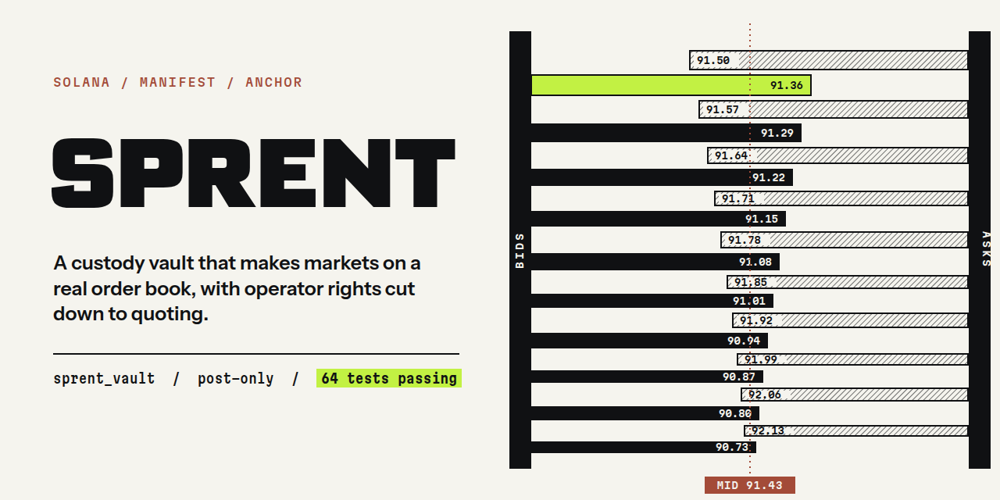

# SPRENT

<a href="https://sprent.pro">Website</a> &nbsp;/&nbsp;
<a href="https://x.com/sprent_pro">X</a> &nbsp;/&nbsp;
<a href="https://github.com/sprentpro/sprent-vault">Source</a> &nbsp;/&nbsp;
<a href="https://github.com/sprentpro">Organization</a> &nbsp;/&nbsp;
<a href="VERIFY.md">Verification</a>

**On-chain market-making desks, with custody and accounting in the program.**

## Overview

SPRENT is a custody vault on Solana that market-makes a real order book. Depositors put USDC into a desk vault and receive shares on an internal ledger; an operator key quotes post-only orders on the [Manifest](https://github.com/CKS-Systems/manifest) SOL/USDC market through the vault, and every epoch the vault flattens its venue position, prices its holdings against the Pyth oracle and settles each depositor's share of the result, with a high-water-mark performance fee.

The operator key can place and cancel quotes inside on-chain risk limits. It cannot send funds to an address of its choosing: the vault PDA is the only Manifest trader, Manifest withdrawals land in vault-owned token accounts, and customer withdrawals pay out only to the depositor's own token account. Trading can still lose money, and the admin key and the program upgrade authority carry more power than the operator; see [Trust assumptions](#trust-assumptions).

This repository contains the on-chain program `sprent_vault` (Anchor) and `@sprent/vault-accounting`, a dependency-free TypeScript reference of the vault ledger used by the off-chain indexer.

- Program ID: `GnfjrTU3LuytJm1BSLVWvBM721Jvs1dTQBa4aWAMUw3g` ([devnet explorer](https://explorer.solana.com/address/GnfjrTU3LuytJm1BSLVWvBM721Jvs1dTQBa4aWAMUw3g?cluster=devnet)). Mainnet deployment is pending.
- Venue: Manifest `MNFSTqtC93rEfYHB6hF82sKdZpUDFWkViLByLd1k1Ms` ([Solscan](https://solscan.io/account/MNFSTqtC93rEfYHB6hF82sKdZpUDFWkViLByLd1k1Ms?cluster=mainnet-beta))
- Tests: 64 passing (16 Rust unit tests, 48 TypeScript tests), recorded in [VERIFY.md](VERIFY.md)

