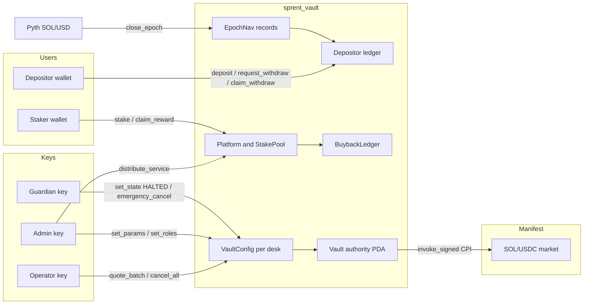
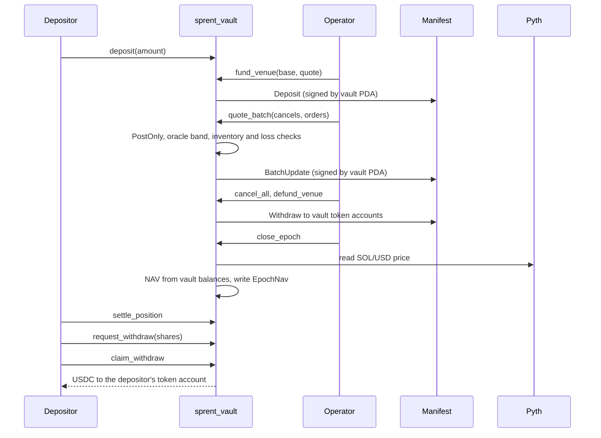
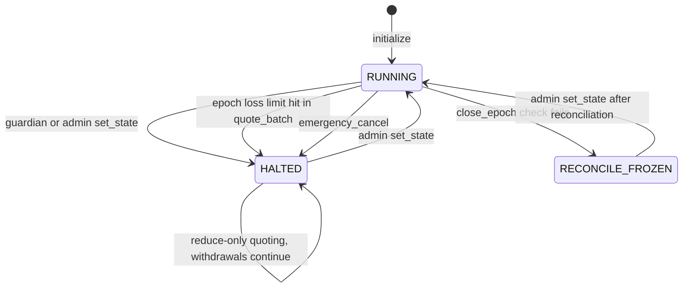
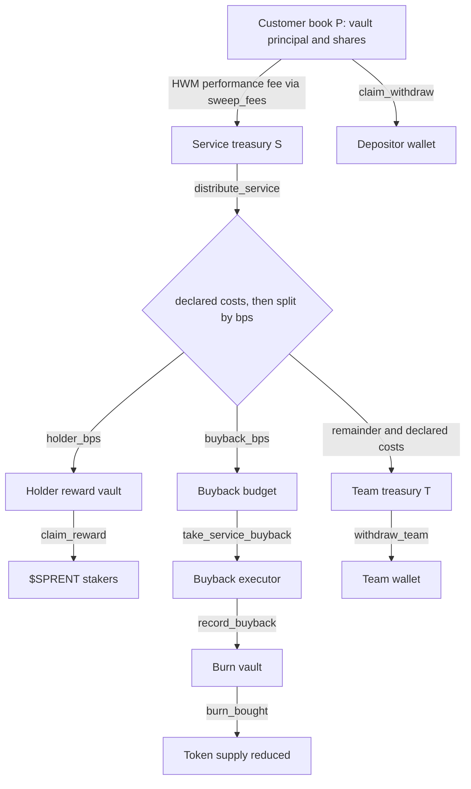
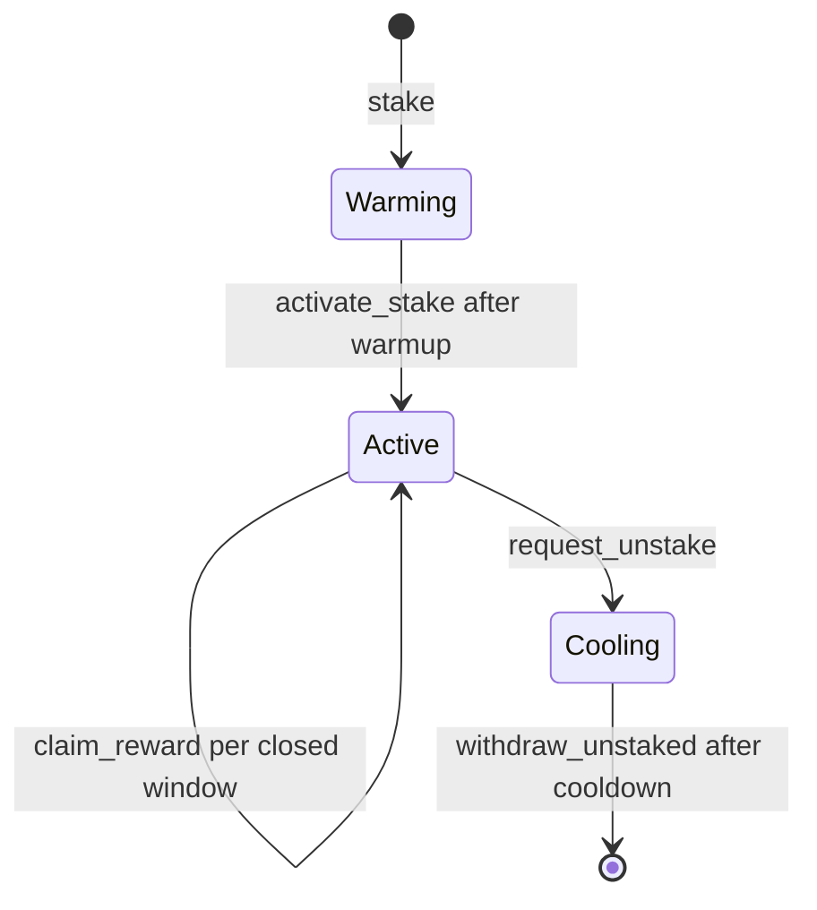

<p align="center"></p>

# SPRENT

<p align="center">
<a href="LICENSE"></a>
<a href="https://solana.com"></a>
<a href="https://www.anchor-lang.com"></a>
<a href="programs/sprent_vault"></a>
<a href="sdk"></a>
<a href="https://github.com/sprentpro/sprent-vault/actions/workflows/ci.yml"></a>
<a href="VERIFY.md"></a>
<a href="https://sprent.pro"></a>
<a href="https://x.com/sprent_pro"></a>
</p>

<p align="center">
<a href="https://sprent.pro">Website</a> &nbsp;/&nbsp;
<a href="https://x.com/sprent_pro">X</a> &nbsp;/&nbsp;
<a href="https://github.com/sprentpro/sprent-vault">Source</a> &nbsp;/&nbsp;
<a href="https://github.com/sprentpro">Organization</a> &nbsp;/&nbsp;
<a href="VERIFY.md">Verification</a>
</p>

**On-chain market-making desks, with custody and accounting in the program.**

## Overview

SPRENT is a custody vault on Solana that market-makes a real order book. Depositors put USDC into a desk vault and receive shares on an internal ledger; an operator key quotes post-only orders on the [Manifest](https://github.com/CKS-Systems/manifest) SOL/USDC market through the vault, and every epoch the vault flattens its venue position, prices its holdings against the Pyth oracle and settles each depositor's share of the result, with a high-water-mark performance fee.

The operator key can place and cancel quotes inside on-chain risk limits. It cannot send funds to an address of its choosing: the vault PDA is the only Manifest trader, Manifest withdrawals land in vault-owned token accounts, and customer withdrawals pay out only to the depositor's own token account. Trading can still lose money, and the admin key and the program upgrade authority carry more power than the operator; see [Trust assumptions](#trust-assumptions).

This repository contains the on-chain program `sprent_vault` (Anchor) and `@sprent/vault-accounting`, a dependency-free TypeScript reference of the vault ledger used by the off-chain indexer.

- Program ID: `GnfjrTU3LuytJm1BSLVWvBM721Jvs1dTQBa4aWAMUw3g` ([devnet explorer](https://explorer.solana.com/address/GnfjrTU3LuytJm1BSLVWvBM721Jvs1dTQBa4aWAMUw3g?cluster=devnet)). Mainnet deployment is pending.
- Venue: Manifest `MNFSTqtC93rEfYHB6hF82sKdZpUDFWkViLByLd1k1Ms` ([Solscan](https://solscan.io/account/MNFSTqtC93rEfYHB6hF82sKdZpUDFWkViLByLd1k1Ms?cluster=mainnet-beta))
- Tests: 64 passing (16 Rust unit tests, 48 TypeScript tests), recorded in [VERIFY.md](VERIFY.md)

## How it works

1. **Deposit.** `deposit` moves USDC from the depositor into the desk's vault token account and queues it. Shares are minted at the next epoch's settled price after the entry delay, so a deposit never buys into a price it has already seen.
2. **Quote.** The operator calls `fund_venue` to move working capital into the vault's Manifest seat and `quote_batch` to cancel and place orders. The program signs the Manifest CPI with the vault PDA, rejects any order type other than PostOnly, rejects prices outside the oracle band, and enforces inventory, bid size and orders-per-batch limits. A loss beyond the epoch loss limit halts the desk; a halted desk can only reduce inventory.
3. **Close the epoch.** `cancel_all` and `defund_venue` bring every order and balance back to the vault. `close_epoch` then requires zero open orders, reads the vault's actual token balances and the Pyth SOL/USD price (staleness, confidence and book-deviation checks) and writes an `EpochNav` record. If a check fails the epoch is frozen for reconciliation instead of being priced.
4. **Settle.** `settle_position` brings one depositor up to the closed epoch: mints queued deposits, crystallises the performance fee above that depositor's own high-water mark and turns matured withdrawal requests into claimable USDC. `sweep_fees` moves crystallised fees to the service treasury.
5. **Withdraw.** `request_withdraw` queues shares behind the cooldown; after settlement `claim_withdraw` pays USDC to a token account owned by the depositor.
6. **Platform.** Net service income is split by `distribute_service` into a holder reward pool for staked $SPRENT, a buyback budget and a team budget. Staking uses a warmup, time-weighted reward windows and an unstake cooldown. Buybacks are tracked as intents on a `BuybackLedger` (opened, recorded with the buy signature, burned), with customer vault accounts rejected as a funding source.

## Architecture











Program accounts:

| Account | Seeds | Holds |
|---|---|---|
| `VaultConfig` | `config`, desk id | roles, mints, venue and oracle addresses, risk parameters, epoch counters, state |
| `Depositor` | `depositor`, config, owner | shares, queued deposit, withdrawal request, per-depositor high-water mark, claimable USDC |
| `EpochNav` | `epoch`, config, epoch | settled NAV, share count, price per share, oracle reading, status |
| `Platform` | `platform` | treasuries, split ratios, allocation totals, exclusion list |
| `StakePool` / `StakeAccount` / `RewardWindow` | `stake_pool`, `stake`, `reward_window` | stake positions and time-weighted reward windows |
| `BuybackLedger` | `buyback`, intent id | buyback intent, spent and bought amounts, pending and burned tokens |

## Repository structure

```text
.
├── Anchor.toml
├── Cargo.toml
├── Cargo.lock
├── rust-toolchain.toml
├── idl/
│   └── sprent_vault.json
├── programs/sprent_vault/
│   ├── Cargo.toml
│   └── src/
│       ├── lib.rs
│       ├── constants.rs
│       ├── errors.rs
│       ├── events.rs
│       ├── helpers.rs
│       ├── accounting.rs
│       ├── manifest.rs
│       ├── oracle.rs
│       ├── state/
│       │   ├── vault.rs
│       │   └── platform.rs
│       └── instructions/
│           ├── setup.rs
│           ├── deposit.rs
│           ├── venue.rs
│           ├── orders.rs
│           ├── epoch.rs
│           ├── withdraw.rs
│           ├── fees.rs
│           ├── admin.rs
│           ├── platform_setup.rs
│           ├── service.rs
│           ├── staking.rs
│           ├── exclusion.rs
│           └── buyback.rs
├── sdk/
│   ├── package.json
│   ├── src/
│   │   ├── accounting.ts
│   │   ├── pnl.ts
│   │   ├── funds.ts
│   │   └── index.ts
│   └── test/
├── assets/
└── VERIFY.md
```

- `lib.rs` declares the program ID and the `#[program]` entry points; each entry point calls its handler in `instructions/`.
- `manifest.rs` builds Manifest instructions from their wire format. The program does not link the Manifest crate.
- `accounting.rs` holds the share, NAV and performance-fee math; `sdk/src/accounting.ts` is an independent TypeScript implementation of the same rules with integer arithmetic.
- `idl/sprent_vault.json` is the Anchor IDL produced by this source.

## Quick start

Requirements: Rust 1.95.0 (pinned in `rust-toolchain.toml`), Solana CLI 3.0.0, Anchor CLI 0.31.1, Node.js 22 or newer.

```bash
git clone https://github.com/sprentpro/sprent-vault.git
cd sprent-vault
bash scripts/build.sh
cargo test -p sprent_vault
cargo fmt --all -- --check

cd sdk
npm ci
npm run lint
npm run build
npm test
```

`bash scripts/build.sh` writes the program to `target/deploy/sprent_vault.so` and the IDL to `target/idl/sprent_vault.json`. [VERIFY.md](VERIFY.md) lists the measured results and how to compare the IDL with `idl/sprent_vault.json`.

The build script pins SBF platform-tools v1.52 and generates the IDL separately.

The accounting package is private to this workspace and is not published on npm. Build it from `sdk/` before consuming it in a local workspace. Its public exports include:

```ts
import { computeNav, mintShares, redeemValue } from "@sprent/vault-accounting";
```

## Security

Report vulnerabilities privately as described in [SECURITY.md](SECURITY.md). Do not open a public issue for a security report.

Design properties enforced in the program:

- The vault PDA is the Manifest trader; the operator key signs only `quote_batch`, `cancel_all`, venue funding and epoch maintenance.
- Orders must be PostOnly and inside the oracle price band; inventory, bid size and batch size are capped by `VaultConfig` risk parameters.
- Desk PDAs (vault authority, `Depositor`, `EpochNav`) are seeded with their `VaultConfig`, and stored addresses are checked on every instruction (`AccountSubstitution`).
- NAV is computed only from flattened vault balances and a checked oracle price; a failed check freezes the epoch for reconciliation.
- Customer vault accounts are rejected as a source for the service treasury, the buyback budget and the team budget.

### Trust assumptions

The program limits what each key can do, but it does not remove trust in the team. Before depositing, assume the following:

- **Upgrade authority.** The program is upgradeable. `initialize` requires the desk admin to be the program's upgrade authority, so one key can both administer the desk and replace the program code. An upgrade can change any rule in this repository. Check the current upgrade authority on [Solscan](https://solscan.io/account/GnfjrTU3LuytJm1BSLVWvBM721Jvs1dTQBa4aWAMUw3g).
- **Admin parameters take effect immediately.** `set_params` has no timelock. Within the bounds in `validate_params`, the admin can raise the performance fee up to 50% (applied at the next settlement), lengthen the withdrawal cooldown and epoch duration (no upper bound), and change deposit caps and risk limits. The admin key itself, the Manifest market, the mints, the oracle account, the Pyth feed id and the oracle mode (Pyth, or a fixed 1:1 peg meant for stablecoin pairs) are fixed at `initialize` and have no setter.
- **Freezing.** The admin can set any desk state, including `RECONCILE_FROZEN`, which blocks `close_epoch`. While frozen no new epoch is priced, so queued deposits are not minted and pending withdrawal requests do not mature. USDC already settled as claimable can still be claimed with `claim_withdraw`.
- **Liveness.** `close_epoch` must be signed by the operator, admin or guardian. `settle_position` and `claim_withdraw` need no team signature, but they depend on epochs being closed.
- **Operator trading.** The operator chooses prices inside the oracle band (up to 20% wide, set by the admin) and sizes inside the inventory and loss limits. Losses inside those limits, including fills against a counterparty the operator controls, are borne by the vault.
- **Service income.** `distribute_service` takes a `declared_costs` amount from the admin; declared costs go to the team treasury before the holder and buyback split.
- **Audit.** The program has not had an external security audit.

